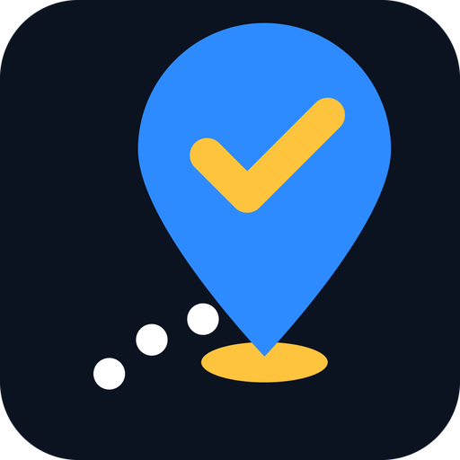

  

<h1 align="center">Sampai</h1>

**Sampai** is an offline navigation app made for Malaysia. Bahasa Melayu first, with toll prices in RM.

## Features

- Offline maps and turn-by-turn navigation, built on [OpenStreetMap](https://openstreetmap.org) data
- Bahasa Melayu interface and voice guidance, plus English, Chinese and Tamil
- Toll total in RM in the route preview and during navigation, for plazas with a fixed price (see `data/my_tolls.csv`)
- Quick search for Malaysian places: fuel, surau, mamak, parking, EV chargers, clinics, rest areas
- No account needed

## Building

See [docs/INSTALL.md](docs/INSTALL.md) for the desktop, Android and iOS builds, and [CLAUDE.md](CLAUDE.md) for the code conventions.

The product plan is in [docs/MALAYSIA.md](docs/MALAYSIA.md) and the UI direction in [design/README.md](design/README.md).

## Acknowledgements

Sampai is built on [Organic Maps](https://organicmaps.app), an open-source project licensed under Apache-2.0, and on map data from OpenStreetMap contributors.

## License and Copyrights

The code is Licensed under the Apache License, Version 2.0. See [LICENSE](LICENSE), [NOTICE](NOTICE),
[data/copyright.html](http://htmlpreview.github.io/?https://github.com/organicmaps/organicmaps/blob/master/data/copyright.html) and [.reuse/dep5](https://github.com/organicmaps/organicmaps/blob/master/.reuse/dep5) for more information.

Binary data files (including, but not limited to `.mwm` map files) are provided under a separate license.
See [DATA_LICENSE.txt](https://github.com/organicmaps/organicmaps/blob/master/DATA_LICENSE.txt) for details.

### Attribution for forks and derivative apps based on Organic Maps

If you use Organic Maps binary data (e.g. maps), source code, or its user interface in your project, include a visible, human-readable mention of the “Organic Maps Project” and a clickable link to https://organicmaps.app.
To respect the work of all project contributors and to comply with license attribution terms, this notice should appear in user-visible locations, such as the product’s “About” and “Main Menu” screens.

### 🤝 White-label

For inquiries about white-labeling or using our servers for your products, please contact us in advance at:

**legal@organicmaps.app**

Thank you!
